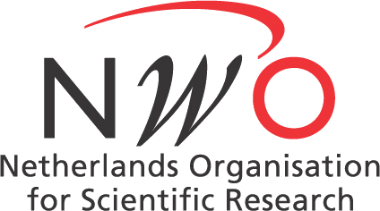

<h4 class="card-title">Research program</h4>


I study how the **limits of neural representation shape everyday decisions**. Payoffs,
probabilities and values are encoded by noisy populations of tuned neurons, and people
decide by inferring what is out there from these noisy codes. Prior knowledge and noise
then produce systematic biases, such as risk aversion, that classical economics
attributes to taste.

My approach combines three things:

-   **Measuring neural codes in individual brains.** With ultra-high-field (7T) fMRI and
    encoding models borrowed from visual neuroscience, I estimate how precisely each
    person's cortex represents a quantity, and decode it back out trial by trial.
-   **Formal models of behaviour.** Bayesian observer and sequential-sampling models
    estimate the same noise and prior from people's choices and response times.
-   **Causal tests.** Brain stimulation, stress, working-memory load and changes in
    context manipulate the code, so we can see whether behaviour changes as predicted.

Next, I want to find out whether the brain builds all of its internal scales, for
number, probability, time, rank and value, with one shared architecture, and whether
the shape of each neural scale predicts where people's judgements are precise and where
they are biased.


{{ aim | markdownify }}

  

    <h4 class="card-title">Positions and education</h4>
  

  

    <h5 class="card-subtitle mb-2 text-muted">2019 – now: Postdoctoral researcher with <a class="text-muted" href="https://www.econ.uzh.ch/en/people/faculty/ruff.html">Prof. Christian C. Ruff</a>, Zurich Center for Neuroeconomics, University of Zurich</h5>
    
I develop the neuroimaging approach and analyses for the lab's work on how
    <strong>perception shapes economic choice</strong>, using <strong>numerical and value
    receptive field models</strong> at 7T, <strong>Bayesian cognitive models</strong> and
    <strong>TMS</strong>. I came to Zurich with an NWO Rubicon fellowship.

    

  

  

    <h5 class="card-subtitle mb-2 text-muted">2017 – 2019: Postdoctoral researcher with <a class="text-muted" href="https://tknapen.github.io/">Dr. Tomas Knapen</a>, Vrije Universiteit Amsterdam and Spinoza Centre</h5>
    
I mapped <strong>ocular dominance columns</strong> and
    <strong>retinotopy</strong> across cortical depth with <strong>0.7 mm functional
    MRI</strong>, in collaboration with the Chinese Academy of Sciences, Beijing.

    

  

  

    <h5 class="card-subtitle mb-2 text-muted">2013 – 2018: PhD (cum laude) with <a class="text-muted" href="https://www.birteforstmann.com">Prof. Birte U. Forstmann</a>, University of Amsterdam</h5>
    
I studied the <strong>subthalamic nucleus</strong>, a small
    subcortical node of the basal ganglia, with <strong>7 Tesla MRI</strong>, histology and
    computational models such as the <strong>drift diffusion model</strong>. The thesis
    received the <a href="http://societyforbrainandcognition.nl/dissertation-award/">
    2018–2019 Dissertation Award of the Dutch Society for Brain and Cognition</a>.

    
<a href="/assets/pdfs/thesis.pdf">Download thesis</a>

    

  

  

    <h5 class="card-subtitle mb-2 text-muted">2010 – 2012: Research Master in Artificial Intelligence, University of Amsterdam</h5>
    
Focus on machine learning and computer vision.

    

  

  

    
<a href="/assets/pdfs/cv_gilles_oct2024.pdf"><strong>Download academic CV</strong></a>

  

<h4 class="card-title">Mentoring</h4>

I co-supervise PhD students in the Ruff lab with Christian Ruff, as their
day-to-day supervisor for imaging, analysis and modelling.

<ul>
<li><strong>Maike F. Renkert</strong>, PhD 2026. Numerical representations in dyscalculia and under stress
(<a href="https://doi.org/10.64898/2026.10.08.757623">dyscalculia preprint</a>, first author).</li>
<li><strong>Saurabh Bedi</strong>, PhD 2026. Efficient coding in perception and value
(<a href="https://doi.org/10.64898/2026.06.08.730978">perception-and-value preprint</a>, first author).</li>
<li><strong>Alina Davydova</strong>, ongoing. Perceptual foundations of loss aversion.</li>
<li><strong>Gaoyang Huang</strong>, ongoing. Neural codes for fractions and proportions.</li>
<li>Earlier, at the University of Amsterdam: <strong>Steven Miletić</strong>, PhD (co-supervised).</li>
</ul>

<h4 class="card-title">Teaching</h4>

<ul>
<li>2025: Workshop on computational methods for neuroeconomics, Soglio, Switzerland
(<a href="https://github.com/Gilles86/computation-in-neuroeconomics-workshop2025/">course material</a>)</li>
<li>2023 – 2024: Programming for data analysis, University of Zurich</li>
<li>2012 – 2018: Lectures on model-based neuroimaging, machine learning and fMRI, University of Amsterdam</li>
</ul>

<h4 class="card-title">Recognition and invited talks</h4>

<ul>
<li>2025: Invited plenary talk, Society for Neuroeconomics annual meeting, Boston</li>
<li>2019: Dissertation Award, Dutch Society for Brain and Cognition</li>
<li>Invited talks: VU Amsterdam (2023, 2026), University of Melbourne and University of
Newcastle (2024), University of Basel (2022), Chinese Academy of Sciences, Beijing (2018),
Radboud University Nijmegen (2017)</li>
</ul>

<h4 class="card-title">Grants</h4>

  

  

    <h5 class="card-title">2018: NWO Rubicon grant</h5>
  

  

    
To join the Zurich Center for Neuroeconomics
    and do research on the role of parietal numerosity representations
    in risky decision-making.

        
1 Jul 2019 - 1 Sep 2021

    
EUR 158,000

  

  
  

  

    

    

      <h5 class="card-title">2021: UZH Forschungskredit</h5>
    

      

      
Sole applicant. To study the influence of TMS on parietal number
          representations during risky choice.

          
1 Dec 2021 - 1 Dec 2022

      
CHF 110,384

      

    
    

  

<h4 class="card-title">Open-source software</h4>

<h5 class="card-subtitle mb-2 text-muted">Maintainer</h5>
<ul>
<li><a href="https://braincoder-devs.github.io/">braincoder</a> - Python package to fit and invert encoding models of neural data</li>
<li><a href="https://github.com/ruffgroup/bauer/tree/main">bauer</a> - Python package to fit Bayesian hierarchical cognitive models of choice</li>
<li><a href="https://nideconv.readthedocs.io/en/latest/">nideconv</a> - Python package to deconvolve (neural) time series</li>
<li><a href="https://pymp2rage.readthedocs.io/en/latest/">pymp2rage</a> - Python package to calculate T1 maps and T1UNI for a MP2RAGE sequence</li>
</ul>

<h5 class="card-subtitle mb-2 text-muted">Contributor</h5>
<ul>
<li><a href="https://bids.neuroimaging.io/">BIDS</a></li>
<li><a href="https://nilearn.github.io/stable/index.html">nilearn</a></li>
<li><a href="https://gallantlab.github.io/pycortex/">pycortex</a></li>
<li><a href="https://www.nipreps.org/niworkflows/master/index.html">niworkflows</a></li>
<li><a href="https://nipype.readthedocs.io/en/latest/">nipype</a></li>
</ul>

<h4 class="card-title">Service</h4>

<ul>
<li>2023 – 2024: Organiser of the weekly Zurich Center for Neuroeconomics seminar</li>
<li>2020 – 2021: Representative of the Rubicon laureates, which helped secure EUR 20M for researchers on short contracts</li>
<li>Reviewer for <em>Science Advances</em>, <em>PNAS</em>, <em>PLOS Biology</em>, <em>eLife</em>, <em>Cerebral Cortex</em>, <em>Human Brain Mapping</em> and <em>Journal of Cognitive Neuroscience</em></li>
</ul>

<h4 class="card-title">Contact information</h4>

Gilles de Hollander  

University of Zurich  

Department of Economics  

Blümlisalpstrasse 10, Room BLU-208  

8006 Zurich  

<a href="mailto:gilles.de.hollander@gmail.com">gilles.de.hollander@gmail.com</a>

ORCID: <a href="https://orcid.org/0000-0003-1988-5091">0000-0003-1988-5091</a>

